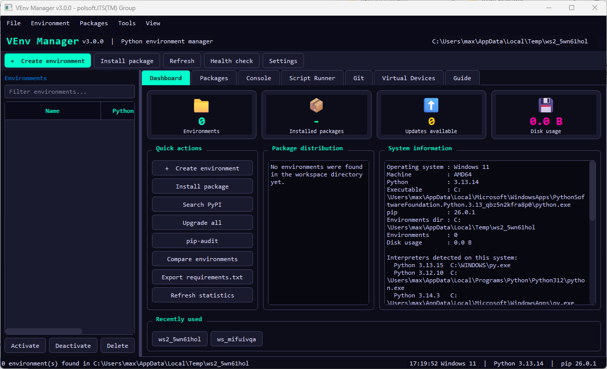

<p align="center">
  
</p>

<p align="center">
  <a href="docs/readme.pl.md">Polski</a> | <strong>English</strong>
</p>

# VEnv Manager

<p>
  
  
  
</p>

**VEnv Manager** is a desktop application for creating and maintaining Python virtual environments. It brings environment and package operations, project tools, and virtual disk-image utilities together in one PyQt6 interface.

## Features

- **Environment management:** discover, create, activate in the application, clone, rename, compare, health-check, and delete virtual environments.
- **Package management:** browse installed packages, install from PyPI or a local distribution, install multiple packages, upgrade or remove packages, inspect package details, check for updates, and freeze dependencies.
- **Dependency workflows:** import `requirements.txt`; export `requirements.txt`, `pyproject.toml`, or Conda `environment.yml`; use `pip-compile` and `pip-sync` through `pip-tools`.
- **Project tools:** dashboard statistics, environment filtering, recent projects, a command console, a script runner, Git actions, Python interpreter and tool detection, and `pip-audit` integration.
- **Virtual devices:** create and manage supported floppy, ISO, VHD, VMDK, QCOW2, and raw disk images. Some formats and operations require optional dependencies or external tools.
- **Personalisation:** seven colour themes, adjustable font settings, configurable paths and command options, keyboard shortcuts, and saved window settings.
- **Background work:** long-running subprocess and package operations report progress and output in the application.

## Requirements

- Python 3 and a Python installation that can install PyQt6.
- PyQt6, installed with `pip install PyQt6`.
- Network access for PyPI operations and package update checks.

The code includes platform-specific handling for Windows and macOS and uses Unix-style commands on other systems. Availability of shells, Git, editors, mount operations, and image tooling depends on the operating system and local configuration.

### Optional virtual-device tools

The application can check for optional Python packages (`pycdlib`, `construct`, and `diskimage`) and the `qemu-img` executable. These are not required to launch the manager; install them only for the image operations that need them. VMDK/QCOW2 creation or conversion relies on `qemu-img`.

## Install and run

Clone or download this repository, then run the following from the project directory.

### Windows (PowerShell)

```powershell
py -m venv .venv
.\.venv\Scripts\Activate.ps1
python -m pip install --upgrade pip
python -m pip install PyQt6
python .\VEnv_Manager.py
```

### macOS or Linux

```bash
python3 -m venv .venv
source .venv/bin/activate
python -m pip install --upgrade pip
python -m pip install PyQt6
python VEnv_Manager.py
```

On Linux, install the platform's Qt system libraries if your Python/PyQt6 distribution requires them. The application is launched from the repository root so Python can import the `venv_manager` package.

## Using the application

1. Open **Settings** and choose the default directory where environments are stored, along with any custom interpreter, editor, or terminal paths.
2. Select **Create environment** and choose the Python interpreter and environment options.
3. Select an environment in the list to inspect its packages and run environment or package actions.
4. Use the dashboard and tabs for console commands, scripts, Git, guides, or virtual devices.
5. Export or import dependency files from the **File** menu when sharing or recreating a project environment.

The application's **Activate** action selects an environment for operations inside VEnv Manager; it does not modify the parent shell's activation state.

## Settings and logs

Configuration and log files are stored in the user's application-data directory, not in the project folder. The exact location is selected by the operating system. The application writes `venv_manager.log` when logging is available. Settings include the default environment directory, executable paths, package-index options, command timeout, theme, font, refresh behavior, and confirmation preferences.

## Project layout

- `VEnv_Manager.py` — application launcher and compatibility exports.
- `venv_manager/config.py` — application settings, themes, translations, and paths.
- `venv_manager/backend.py` — environment/package helpers, workers, and disk-image writers.
- `venv_manager/dialogs.py`, `widgets.py`, `uikit.py`, and `data.py` — dialogs, reusable UI, UI helpers, and static content.
- `venv_manager/window/` — main window and feature tabs/actions.
- `docs/` — screenshots and translated documentation.

## Troubleshooting

- **`PyQt6 is required`:** install it into the same Python environment used to launch the application with `python -m pip install PyQt6`.
- **No environments appear:** check the configured environment directory and verify that it contains standard Python virtual environments.
- **A package operation fails:** check the selected environment, its Python/pip installation, network access, and any configured proxy or package index.
- **An image format is unavailable:** check the optional-dependency status in the Virtual Devices tab and install the required external tool, such as QEMU for `qemu-img` operations.
- **A renamed environment has broken command launchers:** use the clone-and-delete rename flow where available; moving an environment directory can invalidate absolute paths in installed scripts.

## Contributing and support

Please include the operating system, Python version, steps to reproduce, and relevant application log output when reporting a problem. The project owner's public GitHub page is [polsoft-it](https://github.com/polsoft-it). Contact: [polsoft.its@mail.com](mailto:polsoft.its@mail.com).

## License and attribution

Copyright (c) 2026 Sebastian Januchowski and polsoft.ITS(TM). All rights reserved. No separate open-source license is included in this repository; do not assume that redistribution or modification is permitted. Contact the copyright holder for permission.

The application is a PyQt6 rewrite based on VEnv_Manager v2.5.2 (Tkinter edition). Microsoft and the Microsoft logo are trademarks of the Microsoft group of companies. The badges above use a Microsoft-style rectangular presentation and do not imply Microsoft affiliation or endorsement.

<p align="center">
  <sub>author: Sebastian Januchowski<br>company: polsoft.ITS™</sub><br>
  <a href="mailto:polsoft.its@mail.com"></a>
  <a href="https://github.com/polsoft-it"></a>
</p>