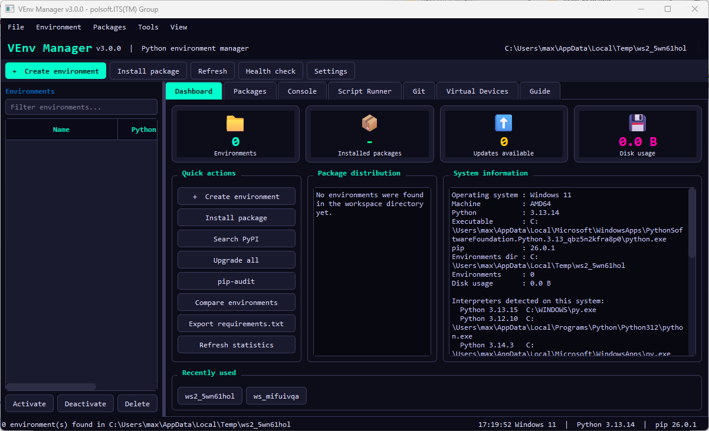

<p align="center">
  
</p>

<p align="center">
  <strong>Polski</strong> | <a href="../README.md">English</a>
</p>

# VEnv Manager

<p>
  
  
  
</p>

**VEnv Manager** to aplikacja desktopowa do tworzenia i obsługi wirtualnych środowisk Pythona. Łączy zarządzanie środowiskami i pakietami, narzędzia projektowe oraz obsługę wirtualnych obrazów dysków w interfejsie PyQt6.

## Funkcje

- **Zarządzanie środowiskami:** wykrywanie, tworzenie, wybieranie środowiska do operacji w aplikacji, klonowanie, zmiana nazwy, porównywanie, diagnostyka i usuwanie środowisk.
- **Zarządzanie pakietami:** przegląd zainstalowanych pakietów, instalacja z PyPI lub lokalnego pliku, instalacja wielu pakietów, aktualizacja i usuwanie, szczegóły pakietów, sprawdzanie aktualizacji oraz eksport listy przez `pip freeze`.
- **Obsługa zależności:** import `requirements.txt`; eksport `requirements.txt`, `pyproject.toml` lub Conda `environment.yml`; obsługa `pip-compile` i `pip-sync` z pakietu `pip-tools`.
- **Narzędzia projektowe:** statystyki pulpitu, filtrowanie środowisk, ostatnie projekty, konsola poleceń, uruchamianie skryptów, narzędzia Git, wykrywanie interpreterów i narzędzi oraz integracja z `pip-audit`.
- **Urządzenia wirtualne:** tworzenie i obsługa wybranych obrazów dyskietek, ISO, VHD, VMDK, QCOW2 i RAW. Niektóre formaty i operacje wymagają dodatkowych bibliotek lub programów.
- **Personalizacja:** siedem motywów kolorystycznych, ustawienia czcionek, konfigurowalne ścieżki i opcje poleceń, skróty klawiaturowe oraz zapamiętywanie ustawień okna.
- **Praca w tle:** długotrwałe polecenia i operacje na pakietach raportują postęp oraz wyjście w aplikacji.

## Wymagania

- Python 3 oraz instalacja Pythona umożliwiająca instalację PyQt6.
- PyQt6, instalowany poleceniem `pip install PyQt6`.
- Dostęp do sieci dla operacji PyPI i sprawdzania aktualizacji pakietów.

Kod uwzględnia Windows i macOS, a na pozostałych systemach korzysta z poleceń uniksowych. Dostępność powłoki, Git, edytorów, montowania systemów plików i narzędzi do obrazów zależy od systemu oraz lokalnej konfiguracji.

### Opcjonalne narzędzia urządzeń wirtualnych

Program może sprawdzać opcjonalne pakiety Pythona (`pycdlib`, `construct`, `diskimage`) i program `qemu-img`. Nie są one wymagane do uruchomienia menedżera; zainstaluj je tylko wtedy, gdy są potrzebne do wybranych operacji na obrazach. Tworzenie lub konwersja VMDK/QCOW2 korzysta z `qemu-img`.

## Instalacja i uruchomienie

Sklonuj repozytorium lub pobierz jego pliki, a następnie wykonaj polecenia w katalogu projektu.

### Windows (PowerShell)

```powershell
py -m venv .venv
.\.venv\Scripts\Activate.ps1
python -m pip install --upgrade pip
python -m pip install PyQt6
python .\VEnv_Manager.py
```

### macOS lub Linux

```bash
python3 -m venv .venv
source .venv/bin/activate
python -m pip install --upgrade pip
python -m pip install PyQt6
python VEnv_Manager.py
```

W systemie Linux zainstaluj biblioteki systemowe Qt, jeśli wymaga ich używana dystrybucja Pythona lub PyQt6. Aplikację uruchamiaj z katalogu głównego repozytorium, aby Python mógł zaimportować pakiet `venv_manager`.

## Korzystanie z aplikacji

1. Otwórz **Settings** i ustaw domyślny katalog środowisk oraz, w razie potrzeby, niestandardowe ścieżki do interpretera, edytora lub terminala.
2. Wybierz **Create environment**, a następnie wskaż interpreter Pythona i opcje środowiska.
3. Wybierz środowisko z listy, aby sprawdzić pakiety i wykonać operacje na środowisku lub pakietach.
4. Skorzystaj z pulpitu i kart, aby używać konsoli, uruchamiać skrypty, pracować z Git, przeglądać przewodnik lub obsługiwać urządzenia wirtualne.
5. Importuj lub eksportuj pliki zależności z menu **File**, aby udostępnić albo odtworzyć środowisko projektu.

Akcja **Activate** wybiera środowisko do operacji wykonywanych przez VEnv Manager. Nie zmienia stanu aktywacji powłoki, z której uruchomiono program.

## Ustawienia i logi

Pliki konfiguracji i logów są przechowywane w katalogu danych aplikacji użytkownika, a nie w katalogu projektu. Dokładną lokalizację wybiera system operacyjny. Jeśli zapis logów jest dostępny, program tworzy `venv_manager.log`. Ustawienia obejmują katalog środowisk, ścieżki do programów, opcje indeksu pakietów, limit czasu poleceń, motyw, czcionkę, odświeżanie i potwierdzanie operacji.

## Struktura projektu

- `VEnv_Manager.py` — uruchamianie aplikacji i eksport zgodności wstecznej.
- `venv_manager/config.py` — ustawienia, motywy, tłumaczenia i ścieżki.
- `venv_manager/backend.py` — narzędzia środowisk i pakietów, zadania w tle oraz zapis obrazów dysków.
- `venv_manager/dialogs.py`, `widgets.py`, `uikit.py` i `data.py` — okna dialogowe, komponenty interfejsu, pomocnicze API i dane statyczne.
- `venv_manager/window/` — główne okno, karty i akcje funkcji.
- `docs/` — zrzuty ekranu i tłumaczenia dokumentacji.

## Rozwiązywanie problemów

- **`PyQt6 is required`:** zainstaluj PyQt6 w tym samym środowisku Pythona, z którego uruchamiasz aplikację: `python -m pip install PyQt6`.
- **Brak widocznych środowisk:** sprawdź skonfigurowany katalog i upewnij się, że zawiera standardowe środowiska wirtualne Pythona.
- **Operacja na pakiecie nie działa:** sprawdź wybrane środowisko, instalację Pythona i pip, połączenie z siecią oraz ustawienia proxy lub indeksu pakietów.
- **Niedostępny format obrazu:** sprawdź status opcjonalnych zależności w karcie Virtual Devices i doinstaluj wymagane narzędzie, np. QEMU dla operacji `qemu-img`.
- **Po zmianie nazwy środowisko nie uruchamia poleceń:** jeśli to możliwe, użyj przepływu klonowania i usuwania. Przeniesienie katalogu może unieważnić ścieżki bezwzględne w zainstalowanych skryptach.

## Współpraca i pomoc

Zgłaszając problem, podaj system operacyjny, wersję Pythona, kroki odtworzenia i odpowiedni fragment logu aplikacji. Publiczna strona GitHub właściciela projektu: [polsoft-it](https://github.com/polsoft-it). Kontakt: [polsoft.its@mail.com](mailto:polsoft.its@mail.com).

## Licencja i autorstwo

Copyright (c) 2026 Sebastian Januchowski i polsoft.ITS(TM). Wszelkie prawa zastrzeżone. Repozytorium nie zawiera osobnej licencji open source; nie należy zakładać, że redystrybucja lub modyfikacja są dozwolone. W celu uzyskania zgody skontaktuj się z właścicielem praw autorskich.

Aplikacja jest przepisaniem VEnv_Manager v2.5.2 (wersji Tkinter) z użyciem PyQt6. Microsoft i logo Microsoft są znakami towarowymi podmiotów z grupy Microsoft. Odznaki wykorzystują prostokątny styl prezentacji kojarzony z projektami Microsoft i nie oznaczają współpracy ani rekomendacji Microsoft.

<p align="center">
  <sub>author: Sebastian Januchowski<br>company: polsoft.ITS™</sub><br>
  <a href="mailto:polsoft.its@mail.com"></a>
  <a href="https://github.com/polsoft-it"></a>
</p>